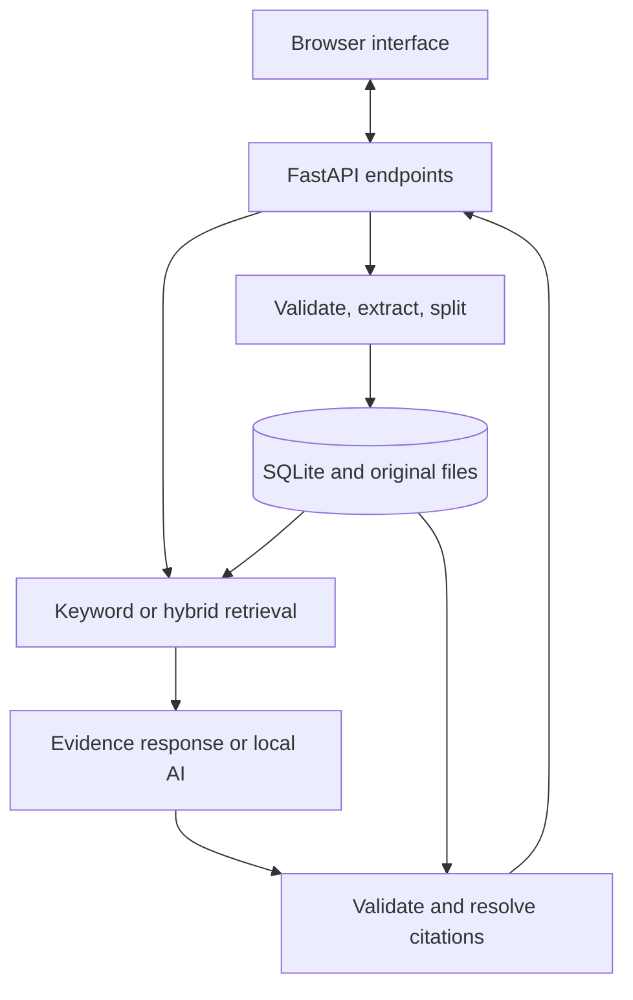

# Design notes

FastAPI serves the browser assets and JSON API. SQLite stores document text and
search data. Evidence mode returns passages; AI mode sends those passages to a
local Ollama model and validates its response.

## Stack choices

SQLite provides storage and keyword search without another service to install.
Serving the UI from FastAPI keeps browser requests on the same origin. Ollama's
HTTP API keeps model dependencies outside the Python environment, which also
makes it easier to substitute a fake client in tests.

## Data flow



The HTTP layer handles transport and request validation. `Research` coordinates
the use cases. `Store` handles persistence. `Retriever` handles ranking. `Ollama`
handles model requests. `IndexJobs` manages a single background embedding worker.
Successful research results are saved as snapshots in the same database.
Extraction and splitting are pure functions, so their offset and coverage tests
do not need a server or database.

## Source identity

`documents` stores a UUID, display filename, SHA-256 hash, type, byte size, counts,
and creation time. Original files are stored with generated UUID filenames.
The provided filename is never used as a disk path.

`pages` stores normalized extracted text. TXT/MD have one logical text unit with
no PDF page number. PDF text units keep their actual page number, including gaps
for blank pages.

`chunks` stores the document ID, passage order, source text, page, zero-based
character start, exclusive end, and one-based line range. Chunks stay within a PDF
page. The inspector fetches the original text unit and highlights `[start:end]`.
PDF positions refer to extracted page text, not a visual bounding box.

New uploads target 700 characters per passage with 120 characters of overlap.
The splitter prefers a paragraph break beyond halfway through the window, falls
back to whitespace, and advances the overlap start to a word boundary. Exact
offsets are checked independently of how the boundaries are chosen.

The globally increasing chunk ID gives a source label such as `S12`. Inline AI
markers use `[S12]`. References resolve to stored chunks, not model-supplied URLs.
Source rows disappear when a document is deleted.

## Keyword retrieval

The query is tokenized with Unicode-aware regular expressions. Common English
question words are removed, and single-digit numeric terms are retained. Up to
16 distinct terms become quoted FTS concept groups joined with OR. A deliberately
small alias map expands `timeline` to schedule/duration/week and connects
stored/storage. SQL uses bound parameters; user FTS operators are not executed.

FTS5 uses `porter unicode61 remove_diacritics 2`, combining Unicode tokenization
with English stemming. Word variants such as approve/approval and
exception/exceptions can match. The stored source text remains unchanged.

Up to six times the requested count are fetched in BM25 order. The same FTS
tokenizer checks how many distinct concept groups each candidate matches. A
single-term query needs one match; a longer query needs at least two and at least
half its concepts, rounded up. Every numeric term must match. Candidates sort by
coverage first, then retain BM25 order to break ties. For example, `pilot telescope`
no longer returns a passage merely because it mentions the pilot.

Highly overlapping chunks from the same text unit are then removed. FTS snippets
center browser previews on matched concepts, including stems and aliases; source
inspection still uses the full passage. Coverage is a heuristic, not a calibrated
confidence score. It can discard useful partial matches. English stemming and
stop words need separate evaluation for other languages.

## Semantic retrieval

Ollama generates passage embeddings in batches of eight. The adapter validates
vector counts, numeric values, finite norms, and dimensions, then normalizes each
vector. SQLite stores the vector as JSON, its dimensions, and the model name.
Indexing reuses existing vectors and saves completed batches, so failed indexing
can be retried. A force rebuild clears selected cached vectors first.

The browser creates an `IndexJobs` task and polls its status. One worker and a
shared index lock prevent overlapping builds through either indexing endpoint.
The job tracks processed/pending passage counts and errors. Cancellation sets a
threading event; the current HTTP embedding call finishes or times out, its valid
results are saved, and the worker stops before the next batch. App shutdown also
requests cancellation and joins the worker outside the event loop.

Job records are in memory, limited to 20 retained records. The browser keeps the
current job ID in session storage to reconnect after a reload. A server restart
loses job records; the database retains completed embeddings, and starting a new
job resumes the cache. Search and document uploads can continue while indexing.
Documents uploaded after a job takes its initial snapshot need another build.

For a hybrid query, the same model embeds the query. Python scores cached passage
vectors with cosine similarity, retaining positive similarities. Numeric query
terms must also occur in semantic candidate text; broader semantic relevance
does not use the keyword coverage gate. Keyword and semantic lists combine using
reciprocal-rank fusion: each rank contributes `1 / (60 + rank)`. Ranking positions
are combined because BM25 and cosine scores are on different scales. Scores are
not presented as answer-confidence percentages.

Vector search currently scans the cached embeddings in Python. This is simple
enough for a small library; larger datasets will need a vector index and workload
measurements.

## Answer generation and its limits

The prompt includes the question and up to six retrieved passages. Document
instructions are described as untrusted data. Ollama is asked for structured
JSON with `answer`, integer `citations`, and boolean `abstained` fields.

The validator rejects missing fields, wrong types, duplicate IDs, unknown IDs,
differences between inline markers and declared citations, citations on an
abstention, and an uncited answer that claims to be supported. No retrieval
matches results in a deterministic abstention before model generation.

An invalid schema or citation response triggers one fresh generation attempt
with additional formatting instructions. The retry uses the same retrieved
evidence and is validated identically. A second invalid answer is withheld.
Service failures are reported directly and do not trigger this repair. The
response records `repaired=true` when the extra attempt succeeds. Each model
request has a 90-second timeout; the browser allows five minutes for a hybrid
query followed by generation and an optional repair.

These are identity and formatting checks. A model can cite a real passage and
still misunderstand it, miss a conflicting source, or obey an injected instruction.
Claim entailment is not automatically verified. The UI encourages inspection,
and the evaluation documentation distinguishes retrieval from answer quality.

## Saved research and migration

`research_runs` stores a UUID, timestamp, query, action, and JSON result snapshot.
`run_documents` links each snapshot to the documents whose passages it contains
and to its selected document scope, if any. The newest 100 successful results are
kept by default, including no-evidence responses. A saved result opens without
retrieval or generation, even if the AI service is offline.

Before saving, source and document IDs are rechecked inside a locked transaction.
If a source disappeared during model generation, a 409 response withholds the
stale result. Document deletion also deletes linked history snapshots, so a
saved result cannot keep displaying text from a removed document. Clearing
history removes snapshots without removing documents or embeddings.

The browser exports a selected snapshot as Markdown: query, mode, retrieval,
timestamp, model, answer, and all retrieved source passages. Sources distinguish
cited and inspection-only passages. Metadata is escaped, and untrusted answer
and source text use fences longer than any contained backtick sequence. Exported
files are independent copies and cannot be removed by later library deletion.

### Upgrading from v0.1

Stop the old server and back up the entire data directory before installing the
new source. If moving to a new project folder, copy the old `data/` folder into
it, or point `BRAVETRACE_DATA_DIR` at the existing directory.

`PRAGMA user_version` identifies schema version 2. Version 1 upgrades inside a
transaction: its derived FTS index is rebuilt with the new tokenizer, and history
tables are added. Documents, chunk IDs/offsets, files, and vectors survive the
migration. Existing chunks are not regenerated. The new splitting settings apply
to new uploads; removing and re-uploading an old document creates new source IDs
and removes its related history. A newer, unknown schema is rejected. Returning
to v0.1 requires the original data backup.

## API map

| Method and path | Purpose |
|---|---|
| `GET /` | Browser application |
| `GET /api/health` | Process response and storage counts |
| `GET /api/status` | Storage counts and local model availability |
| `GET /api/documents` | List metadata and embedding progress |
| `POST /api/documents` | Upload one multipart `file` |
| `DELETE /api/documents/{id}` | Delete stored document and derived records |
| `GET /api/documents/{id}/download` | Download original file as an attachment |
| `GET /api/chunks/{id}` | Source passage plus its text unit |
| `POST /api/search` | Ranked evidence search |
| `POST /api/ask` | Evidence-mode response or AI answer |
| `POST /api/index` | Synchronous build/rebuild; retained for compatibility |
| `POST /api/index-jobs` | Start a background build/rebuild; returns 202 and job ID |
| `GET /api/index-jobs/{id}` | Read job progress, status, and error |
| `POST /api/index-jobs/{id}/cancel` | Request cooperative cancellation |
| `GET /api/history` | List saved research metadata, newest first |
| `GET /api/history/{id}` | Retrieve a saved result snapshot |
| `DELETE /api/history/{id}` | Delete one saved result |
| `DELETE /api/history` | Clear saved results; documents remain |
| `POST /api/demo` | Idempotently load fictional examples |
| `GET /api/docs` | Generated interactive API documentation |

Example request:

```json
{
  "query": "How long are audit logs retained?",
  "mode": "ai",
  "retrieval": "keyword",
  "document_id": null,
  "limit": 6
}
```

## Reliability and tradeoffs

Foreign keys cascade deletions. FTS triggers run within document transactions.
SHA-256 uniqueness prevents duplicate records; a process-local lock coordinates
duplicate uploads. A failed database insertion removes the newly written file.
A process crash can still leave an orphan file; a future cleanup job can reconcile
filesystem records. Use one server process for this version.

Request bytes are capped before multipart parsing, including chunked requests.
Extraction also limits upload bytes, page count, and extracted character count.
PDF parsing is not sandboxed; hostile parsing needs process isolation for a public
upload service. An index lock prevents overlapping rebuilds. Two slots bound
concurrent answer generation. These are local safeguards, not internet-grade
rate limiting or multi-user isolation.

The frontend renders document text, filenames, errors, and model output as text
nodes. It does not interpret them as HTML or Markdown. A same-origin check blocks
browser mutation requests from other origins; local hostnames are allowlisted.
The main UI uses a restrictive content security policy and no external assets.
Interactive API documentation may load Swagger resources from a CDN.

## Next steps

1. Evaluate a live local model on answerable, unanswerable, conflicting, and
   adversarial document questions; preserve inputs and reviewed outputs.
2. Measure coverage/stemming tradeoffs, semantic relevance, and conflict handling
   against a larger independent evaluation corpus.
3. Add streaming generation with an explicit policy for unvalidated output.
4. Add OCR and benchmark extraction on multi-column PDFs and tables.
5. For public demonstration, build a read-only sample-data mode or authenticated
   upload workflow, request quotas, durable storage, and deployment configuration.
